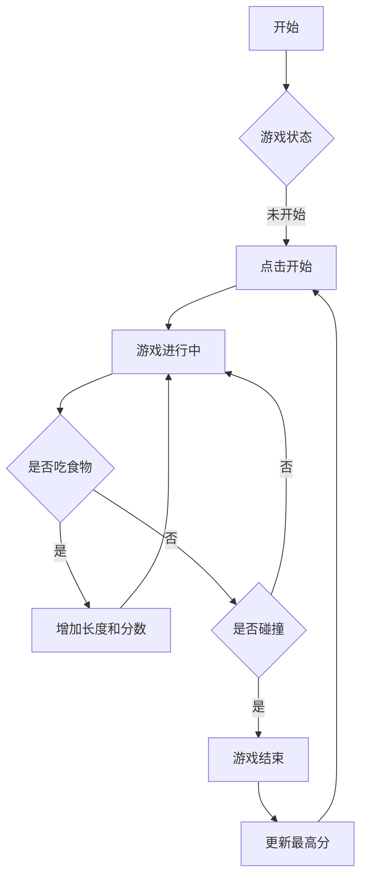

# 产品需求文档 (PRD)

## 1. 产品概述
一个视觉风格独特的贪吃蛇游戏，采用复古未来主义（Neon/Cyberpunk）的霓虹美学。
- 核心目标是提供一个视觉体验极佳的经典游戏重制版。
- 目标用户为喜欢休闲游戏和复古风格的玩家。

## 2. 核心功能

### 2.1 功能模块
1. **游戏主页**: 包含游戏画布、分数显示、控制说明、开始/暂停按钮。
2. **游戏逻辑**: 蛇的移动、吃食物变长、撞墙或撞自己死亡、速度随分数增加而变快。
3. **数据持久化**: 本地存储最高分。

### 2.2 页面详情
| 页面名称 | 模块名称 | 功能描述 |
| page name | module name | feature description |
|-----------|-------------|---------------------|
| 游戏主页 | 游戏画布 | 显示蛇、食物、网格背景。支持键盘方向键控制。 |
| 游戏主页 | 状态面板 | 显示当前分数、历史最高分。 |
| 游戏主页 | 控制栏 | 开始游戏、暂停/继续、重新开始。 |

## 3. 核心流程
用户打开页面 -> 点击开始或按空格键 -> 蛇开始移动 -> 使用方向键控制方向 -> 吃食物得分 -> 撞击结束 -> 显示游戏结束弹窗 -> 重新开始。

## 4. 用户界面设计

### 4.1 设计风格
- **配色**: 深色背景 (#0a0a0a)，霓虹绿/粉/蓝作为蛇和食物的颜色，带有发光效果 (box-shadow)。
- **字体**: 复古像素字体或等宽科技字体 (如 "Press Start 2P" 或 "Orbitron")。
- **布局**: 居中布局，类似于街机屏幕。
- **动效**: 蛇移动时的平滑过渡，吃食物时的粒子效果（如果时间允许），界面元素的呼吸灯效果。

### 4.2 页面设计概览
| 页面名称 | 模块名称 | UI 元素 |
|-----------|-------------|-------------|
| 游戏主页 | 整体容器 | CRT 屏幕扫描线效果遮罩，深色网格背景。 |
| 游戏主页 | 游戏区域 | 边框发光，内部为网格。蛇身为高亮方块。 |
| 游戏主页 | 分数板 | 数字跳动效果，霓虹字体。 |

### 4.3 响应式
- 优先适配桌面端（键盘操作）。
- 移动端适配：增加虚拟方向键或手势滑动控制。

### 4.4 3D 场景指引 (不适用)
- 本项目为 2D 游戏，使用 Canvas 或 Grid 布局实现。
